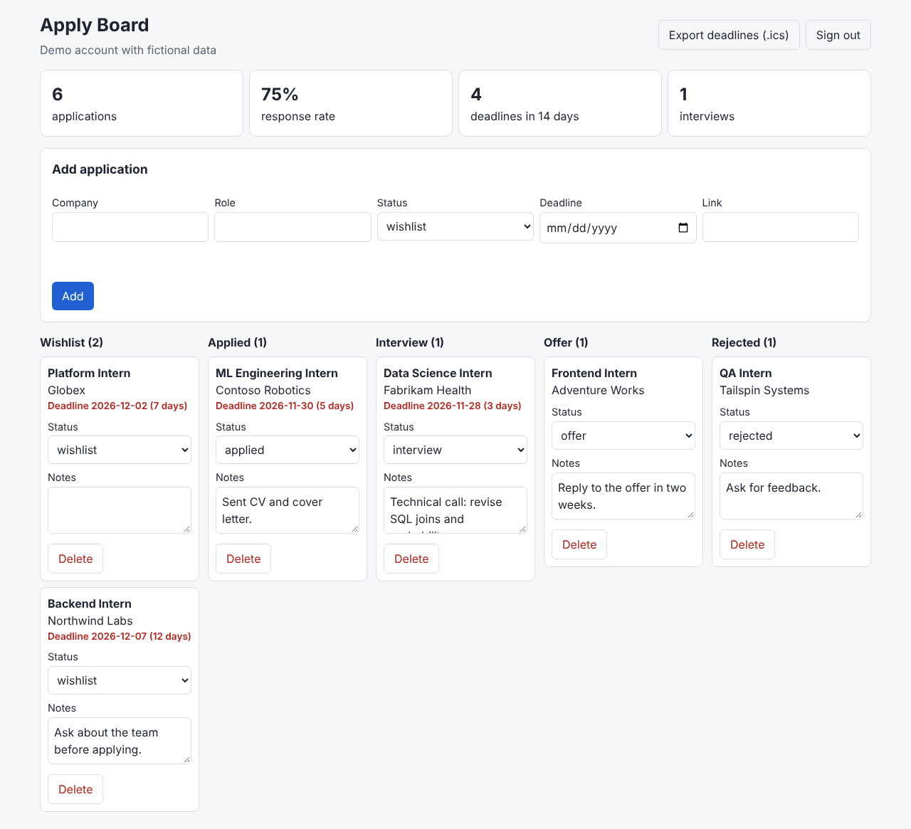
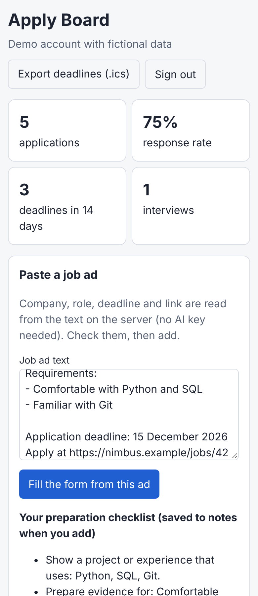
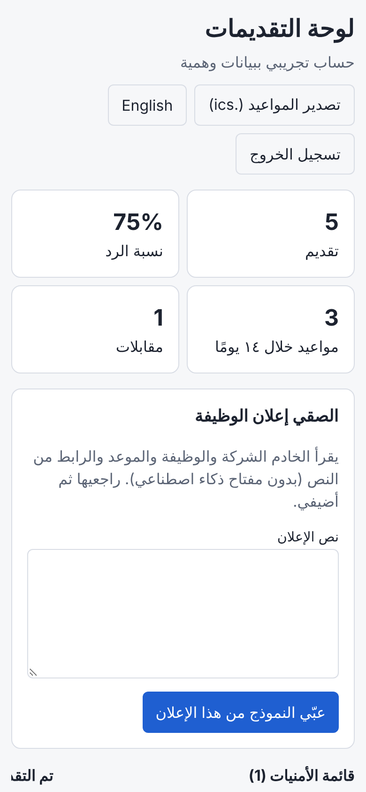
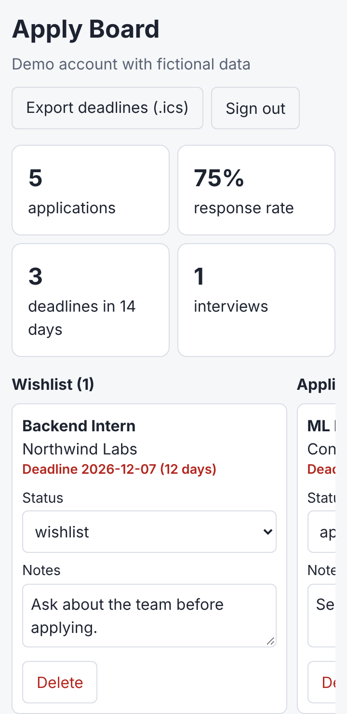

# Apply Board

A small full-stack app for tracking internship applications. Add an application, move it through
`wishlist → applied → interview → offer / rejected`, keep notes, see which deadlines are close and export
them to your calendar as an `.ics` file.



*Screenshot taken from the running app with the built-in demo account (fictional companies).*

## Features

- Accounts: email + password (bcrypt, 12 rounds), random session tokens stored only as SHA-256 hashes,
  `HttpOnly` + `SameSite=Lax` cookie, 7-day sessions, a limit of 5 failed logins per email per 15 minutes.
- Board with five status columns, add / edit status / edit notes / delete.
- Summary: totals, response rate (share of submitted applications that got an interview, offer or rejection),
  deadlines in the next 14 days.
- Paste a job ad: `POST /api/parse-ad` reads company, role, deadline (ISO, `15/12/2026` or "15 December 2026"), link and the
  bullets under "Requirements" from the text with a local rule-based parser (no AI key, no network call, nothing stored).
  The board fills the form, you correct it, and a preparation checklist built from the skills and deadline it found is saved
  in the notes. Fields it cannot find stay empty. It is rule-based, so unusual layouts may be only partly read.
  

  Arabic (RTL) interface, real screenshot at phone width:

  
- Calendar export: `GET /api/applications/export` returns RFC 5545 all-day events (escaped and line-folded).
- Demo mode: one click creates a throw-away account filled with fictional data. Set `ENABLE_DEMO=0` to hide it.
- Every query is scoped to the signed-in user and parameterised; input is validated with Zod at the API boundary.

## Tech

Next.js 15 (App Router) · React 19 · TypeScript (strict) · SQLite via `better-sqlite3` · Zod · bcryptjs ·
Vitest · ESLint · GitHub Actions.

## Run it

Requires Node.js 22.

```bash
npm ci
cp .env.example .env.local   # optional; defaults work
npm run dev                  # http://localhost:3000
```

The SQLite file is created at `DATABASE_PATH` (default `./data/app.db`). The schema is created with
`CREATE TABLE IF NOT EXISTS`, so starting the app twice is safe. No secret or API key is needed.

## Install on your phone

Apply Board is an installable PWA (manifest, 192/512 px icons incl. a maskable one, service worker). Serve it over HTTPS
(or `localhost`), open it in the phone browser, then:

- **Android (Chrome):** menu → *Add to Home screen* / *Install app*.
- **iPhone (Safari):** Share → *Add to Home Screen*.

On a phone the Kanban columns become a swipeable row (scroll-snap) and every button and field is at least 44 px high.
The service worker caches only the app shell (icons, manifest, offline page, static assets). Pages and `/api/*` are never
cached, so there is no stale or cross-user data; offline you see a clear "You are offline" page instead of the board.
Verified in headless Chromium at 360 px: service worker registered, no horizontal scroll, offline fallback shown.
Not verified on a real phone or on iOS.



## Tests

```bash
npm test            # Vitest: 40 tests, in-memory SQLite
npm run lint
npm run typecheck
npm run build
npx playwright install chromium   # once
npm run e2e         # browser smoke test (builds and starts the app on port 3100)
```

`e2e/smoke.spec.ts` drives a real Chromium at phone width: demo login, paste a job ad, add the application, move it to "Applied", check there is no horizontal scroll, then switch to Arabic and check `dir=rtl`. In CI it runs after the unit tests (the first CI run of this step has not been verified yet).

The tests cover the PWA manifest, icon sizes and the service worker's no-cache rule for the API, validation, per-user data isolation, SQL in text fields, status stats, the `.ics` output
(escaping, folding, year boundary), login throttling, session expiry, CSRF rejection and the demo account.
`npm test` found a real bug while this was built: a "partial update" schema inherited the default status,
so editing only the notes would have reset the status to `wishlist`; it is fixed and has a regression test.

## Architecture

```
src/lib/db.ts            opens SQLite, creates tables (idempotent)
src/lib/schema.ts        Zod schemas and types
src/lib/auth.ts          register / login / sessions / login throttling
src/lib/applications.ts  CRUD scoped by user, stats
src/lib/ics.ts           calendar export
src/lib/parse-ad.ts      local job-ad parser (pure function)
src/lib/handlers.ts      request handlers: (db, Request) -> Response, no framework needed to test them
src/app/api/**/route.ts  thin Next.js routes that call the handlers
src/app/**               pages: sign-in and the board; manifest.ts + register-sw.tsx (PWA)
public/sw.js, offline.html, icons/   service worker, offline page, app icons
tests/                   Vitest suites
```

Handlers take the database and a standard `Request`, so the API tests run without starting a server.

## Limits and ideas

- The login throttle is in memory, so it resets on restart and is per server process.
- Status changes use a select box, not drag-and-drop.
- The interface is available in English and Arabic (RTL) through a language button; the Arabic wording has not been reviewed by a native editor, the job-ad parser reads English ads best, and application data you type is shown as-is.
- Not deployed anywhere yet: it needs a Node server with a writable disk for the SQLite file.
- The GitHub Actions workflow in `.github/workflows/ci.yml` had not run yet when this README was written.
